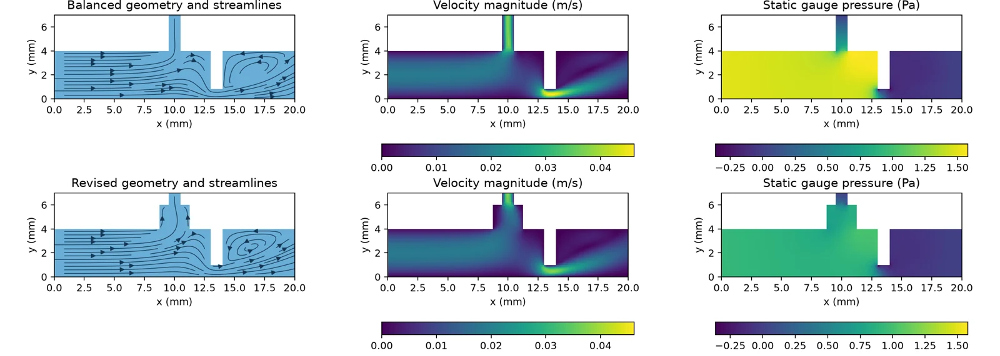
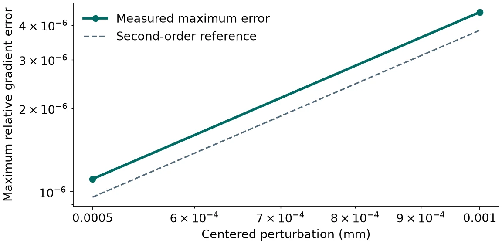
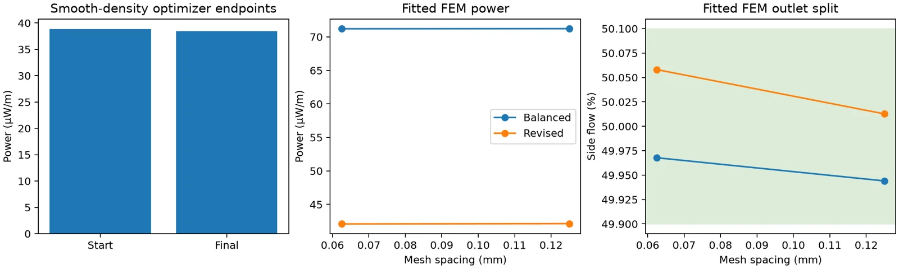
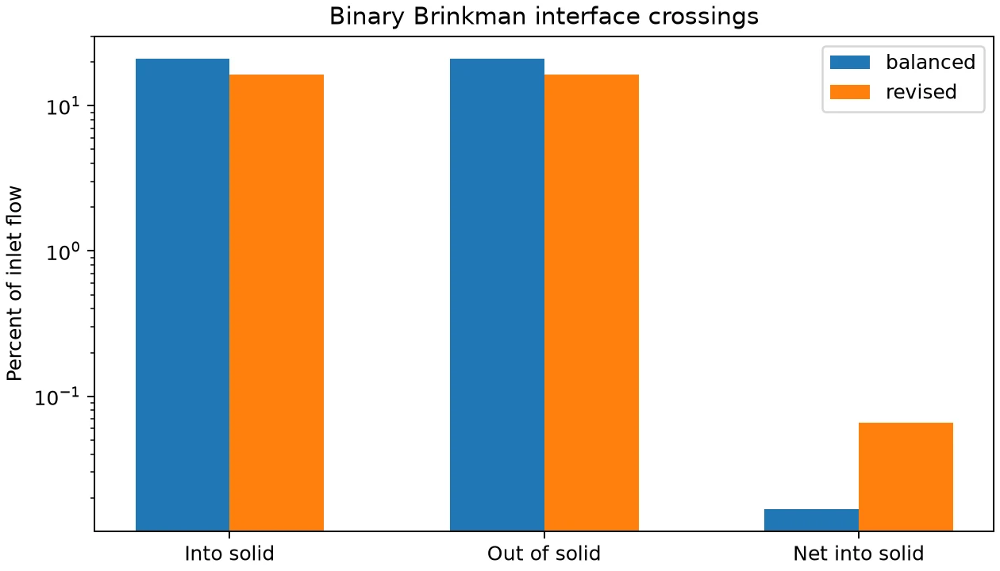

# Coolant manifold design optimization

**Jack Foster · AI Generated · ASU MAE 494 Project 4**

A planar coolant manifold with one inlet and two outlets can cut pumping power while preserving a near-even outlet split. At $Re=50$, the revised fitted-wall design reduced power from **71.2106 to 42.0896 µW/m of depth** and sent **50.0581%** of the flow to the side outlet. The original design sent **49.9678%** to the side. Independent OpenFOAM calculations found a **41.39%** power reduction and a **49.8848%** revised side share.

*The linked 3D views extrude the solved 2D fluid domains by 1 mm for display. Colors represent the archived OpenFOAM finite-volume cell fields, with a common scale across both designs. The live metrics panel uses the fine fitted FEM design checks.*

## Structure and formulation

The 20 mm main passage is 4 mm tall. A fixed 1 mm outlet rises to $y=7$ mm at the center of the branch. The throttle occupies $13<x<14$ mm in the main passage. The branch shoulder opens on both sides below $y=6$ mm. The inlet and outlet apertures are fixed. The design variables are the throat height $h$ and shoulder width per wall $s$, with $0.15\le h\le4$ mm and $0\le s\le1$ mm.

The engineering objective is the net inward flux of pressure work and kinetic energy per unit depth. The port normal points outward, $Q_i=-\int_{\Gamma_i}\mathbf u\cdot\mathbf n\,ds$, and $Q_s=\int_{\Gamma_s}\mathbf u\cdot\mathbf n\,ds$. The design brief sets the near-even split band and the nominal area cap. These are study targets.

$$
P=-\sum_{j=i,m,s}\int_{\Gamma_j}\left(p+\tfrac12\rho|\mathbf u|^2\right)\mathbf u\cdot\mathbf n\,ds,
\qquad 0.499\le Q_s/Q_i\le0.501,
\qquad A_{\mathrm{nom}}=79+h+4s\le83\;\mathrm{mm}^2.
$$

## Flow model and discretization

The custom solver uses steady, incompressible Navier–Stokes flow with a Brinkman drag on the density mesh. For the fitted geometry, the fluid domain ends at the reconstructed boundaries and the drag term is zero.

$$
\nabla\cdot\mathbf u=0,\qquad
\rho(\mathbf u\cdot\nabla)\mathbf u=-\nabla p+\nabla\cdot(2\mu\varepsilon(\mathbf u))-\alpha_{\max}(1-\gamma)^2\mathbf u.
$$

Water properties are $\rho=998.2$ kg/m³ and $\mu=0.001002$ Pa·s. A fully developed parabolic inlet uses $Re=\rho U H/\mu=50$ with $H=4$ mm. Solid walls have no slip. The FEM outlets impose zero symmetric traction. OpenFOAM uses equal fixed static outlet pressure and zero normal velocity gradient. The comparison includes discretization and outlet-model differences.

The FEM uses Taylor–Hood P2 velocity and P1 pressure on affine triangles, sparse assembly and a Newton tangent with both variations of convection. The smooth fluid fraction $\gamma$ uses logistic transitions over the baffle and shoulder design regions. The archived optimization used a fixed 0.25 mm background mesh, 0.125 mm transition parameter and $\alpha_{\max}=10^6$ kg/(m³·s). Fitted verification used nominal 0.125 and 0.0625 mm meshes.

## Verification ladder

| Check | Evidence | Outcome |
|---|---|---|
| Element functions and quadrature | Maximum exact-moment error $1.11\times10^{-16}$ | Pass |
| Fully developed plane channel | Relative velocity error $1.18\times10^{-14}$ and flow error $8.22\times10^{-15}$ | Pass |
| Rotation invariance | Relative velocity error $9.35\times10^{-15}$ and pressure error $3.48\times10^{-14}$ | Pass |
| Manufactured Stokes refinement | Velocity order 3.10–3.13 and pressure order 3.23–3.42 | Pass |
| Manufactured nonlinear flow | Re 35 tangent error $1.08\times10^{-11}$ and velocity error 0.001701 | Pass |
| Uniform Brinkman channel | Exact-profile relative flux error $2.15\times10^{-6}$ | Pass |
| Layered Brinkman channel | Total-flow relative error $1.02\times10^{-6}$. Solid-flow fraction fell from 21.12% to 4.11% as resistance increased. | Pass |
| Flow conservation | Fine fitted FEM mass errors $1.61\times10^{-14}$ and $1.44\times10^{-15}$ | Pass |
| Fine fitted mesh pair | Side-share change 0.02373 and 0.04534 pp, both below 0.05 pp. Power change 0.02932% and 0.11249%, both below 2% | Pass |
| Independent OpenFOAM comparison | 41.39% power reduction. Revised share misses the lower bound by 0.01520 pp | Power corroborated. Split miss recorded |

The seven code-level benchmark rows use Sol 2082615. The fitted pair is Sol 2351149, 2351257 and 2351770. OpenFOAM is Sol 2351347.

## Adjoint sensitivities

Let $R(w,d)=0$ denote the discrete flow equations and $F(w,d)$ a response. Solve $R_w^\mathsf T\lambda=F_w^\mathsf T$ to obtain $dF/dd=F_d-\lambda^\mathsf TR_d$. The fixed-mesh design derivative enters through $d\alpha/dd=-2\alpha_{\max}(1-\gamma)\,d\gamma/dd$. Power differentiates both the port head and the normal velocity. The split uses the quotient rule $df_s=(dQ_s-f_s\,dQ_i)/Q_i$. The two split inequalities reuse one split adjoint. The area gradient $(1,4)$ and the box gradients are explicit.

| Endpoint response derivative | Throat per mm | Shoulder per mm |
|---|---:|---:|
| Power, µW/m per mm | −24.647321 | −3.421664 |
| Side share, percentage points per mm | −32.955785 | +1.538556 |

Sol 2377911 compared these derivatives against fully replayed centered differences. The maximum relative discrepancies at 0.001 and 0.0005 mm were $4.45\times10^{-6}$ and $1.11\times10^{-6}$. The factor-of-four reduction is consistent with second-order centered differences. The earlier fixed-mesh adjoint benchmark also measured Taylor-remainder orders of 1.99898–2.00001 (Sol 2082615). With two variables a centered gradient uses four perturbed state solutions per step, which both responses can reuse. The adjoint uses one transpose solve per independent PDE response after the primal solve. The archive does not provide an isolated runtime comparison for these steps.

## Optimization and first-order optimality

SLSQP used $P/P_{\mathrm{start}}$, the side slacks in percentage points, and the area slack $4-h-4s$. It finished in four iterations. The archive preserves the start and endpoint responses. The figure connects the recorded endpoints only.

| Stage | Throat (mm) | Shoulder (mm) | Power (µW/m) | Side share |
|---|---:|---:|---:|---:|
| Smooth-density starting design | 0.990641 | 0.747707 | 38.84489 | 50.43090% |
| Smooth-density SLSQP endpoint | 1.006679 | 0.748330 | 38.44626 | 49.90000% |
| Direct fitted reconstruction, 0.125 mm | 1.006679 | 0.748330 | 41.5230 | 49.2548% |
| Corrected fitted design, 0.0625 mm | 0.988528 | 0.752868 | 42.08961 | 50.05805% |

The smooth-density optimizer improved its own starting objective by **1.03%** while meeting the prescribed constraints. Wall reconstruction moved the flow outside the target band. A separate area-preserving throat/shoulder correction restored the split. The fitted reference-to-corrected comparison gives the **40.89%** engineering reduction.

The actual CFD endpoint passed a separate KKT audit on Sol. Both active gradients were independent. The lower split multiplier was 0.0183706 and the area cap multiplier was 0.0290874 in the original SLSQP scaling. Primal and dual violations were zero, with stationarity $1.11\times10^{-16}$ and complementarity $5.22\times10^{-14}$. Increasing either constraint slack has a positive first-order objective cost at the endpoint in this scaling. These results describe the smooth-density endpoint. The reconstructed wall has separate feasibility and power evidence. [KKT audit](https://chatgpt.com/library?file_id=libfile_b7ea413319848191890b1039435a9d3c&account_id=personal)

## Nonlinear component

The advective acceleration $(\mathbf u\cdot\nabla)\mathbf u$ supplies the course’s N2 nonlinear component. At $Re=50$ it produces state-dependent momentum transport. Newton's method and the discrete adjoint include the derivative of both velocity factors. The manufactured $Re=35$ problem verifies the implementation against a known solution. On the earlier metering study, Sol 2084088 evaluated both physics models on the same fitted contours and 22,500-triangle meshes.

| Earlier fitted metering design | Stokes side share | Re 50 side share | Stokes pressure loss | Re 50 pressure loss |
|---|---:|---:|---:|---:|
| Baseline | 27.4197% | 24.8871% | 108.4889 | 91.1308 |
| Screened candidate | 26.2853% | 23.7106% | 109.5566 | 92.8386 |

Pressure loss is nondimensional. Including convection reduced baseline side share by 2.5326 percentage points and put both sampled designs below the earlier pressure cap of 95.3198. These were evaluations of two fixed shapes with the earlier 19.5–20.5% split target. A separately optimized Stokes design for the final near-even two-control formulation remains unverified.

## Headline engineering results

| Fitted FEM at Re 50 | Balanced | Revised | Requirement |
|---|---:|---:|---|
| Pumping power (µW/m of depth) | 71.210586 | 42.089610 | Minimize |
| Side-flow share (%) | 49.967802 | 50.058052 | 49.9–50.1, both pass |
| Nominal area (mm²) | 79.814874 | 83.000000 | ≤83, both pass |
| Throat height (mm) | 0.814874 | 0.988528 | 0.15–4, both pass |
| Shoulder width (mm) | 0.000000 | 0.752868 | 0–1, both pass |
| Triangles | 42,784 | 43,492 | Nominal 0.0625 mm |

The binary immersed model gave a revised split of 47.7182%. Gross crossings into and out of the solid were 16.47% and 16.40% of inlet flow, with 0.0654% net. These are integrated interface crossings. A small net crossing alone cannot certify impermeability.

## Scope, evidence, and AI use

This is a steady, planar hydraulic design at Re 50. Temperature, hardware pressure-flow curves and out-of-plane effects are outside the verified model. The baseline and revised areas differ. The OpenFOAM split misses the FEM design band under its numerical and outlet settings. The separate SST study verified native frozen-state assembly, immersed source and wall-distance runtime inputs, and prescribed-state Jacobian and adjoint algebra. A converged turbulent design and its reduced sensitivities remain open.

Source evidence and reproduction commands are indexed in [ReadMe.md](ReadMe.md). The interactive visual loads [results.json](assets/results.json) and uses the validated OpenFOAM data. The report follows the [Project 4 assignment](https://designinformaticslab.github.io/DesignOptimization2025/project4.html).

ChatGPT and Codex helped draft documentation, implement and debug numerical routines, construct the figures, and build the site. The numerical evidence includes exact-solution checks, independent finite differences, cross-solver runs, and checksum-verified replay. One check caught a sparse index reorder that put face coefficients on the wrong rows. The corrected assembly passed three full-state transpose probes. Student authorship and any individual derivation or manual-check credit should reflect the team’s own record.
